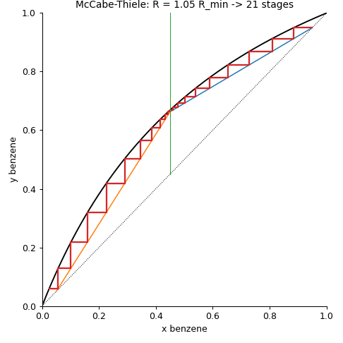
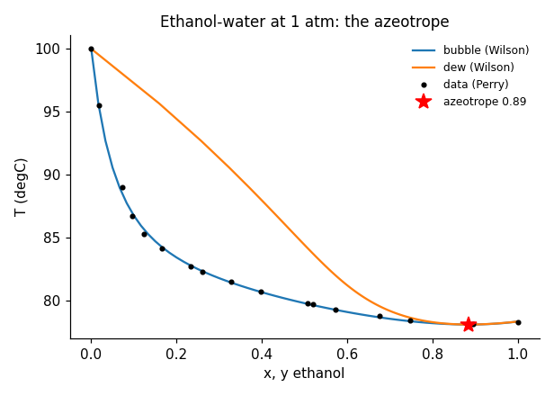
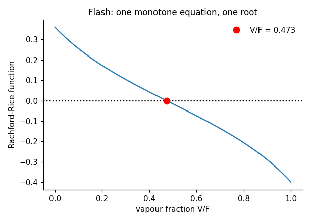
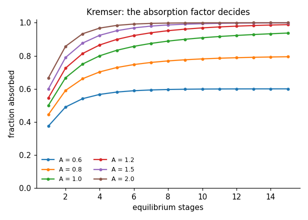
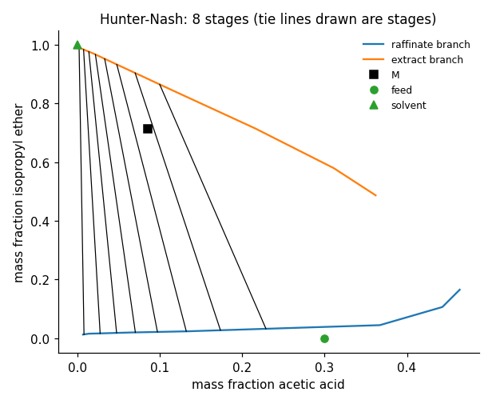
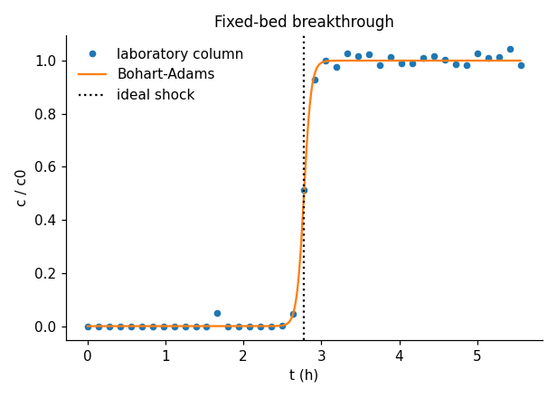
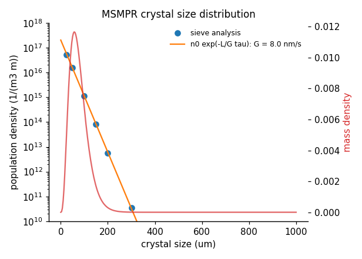

<div align="center">

# engsep

**Separation processes - readable, validated Python, with an 18-notebook course.**

[](https://github.com/ktwyw/engsep/actions/workflows/tests.yml)
[](docs/VALIDATION.md)
[](notebooks)
[](pyproject.toml)
[](LICENSE)
[](https://orcid.org/0000-0002-8488-9833)



</div>

`engsep` covers an undergraduate course in separation processes at the level of Seader, Henley & Roper's
*Separation Process Principles* and Wankat's *Separation Process Engineering*: vapour-liquid equilibrium and
azeotropes, flash, binary and multicomponent distillation, absorption and stripping, packed towers and mass
transfer, liquid-liquid extraction and leaching, adsorption and fixed beds, ion exchange and chromatography,
membrane gas separation, reverse osmosis and ultrafiltration, crystallization, drying and evaporation, and
cooling towers - with applications from refining and desalination to pharmaceuticals, biogas upgrading and
sugar. Every method is checked against analytic solutions, published data and internal consistency between
methods, and a course of executed notebooks with worked solutions teaches the ideas.

```python
from engsep import distillation as dist
from engsep import vle
from engsep.vle import y_from_alpha

vle.azeotrope("ethanol", "water")["x"]                                         # 0.885 mol fraction at 1 atm
alpha = vle.geometric_mean_alpha(("benzene", "toluene"), ideal=True)          # 2.47
mt = dist.mccabe_thiele(lambda x: y_from_alpha(x, alpha), xD=0.95, xB=0.05, zF=0.45, R=2.0)
mt["stages"], mt["feed_stage"]                                                 # (12, 6)
dist.fug(alpha, zF=0.45, xD=0.95, xB=0.05, R_over_Rmin=1.3)["N"]              # Fenske-Underwood-Gilliland: 14.3
```

## Why engsep?

- **Validated, not just tested.** 140 checks in [`docs/VALIDATION.md`](docs/VALIDATION.md), rerun in CI: Antoine
  boiling points against NIST for twenty compounds; the ethanol-water, 2-propanol-water and acetone-methanol
  azeotropes against published values; the Wilson model against the Gibbs-Duhem equation; Fenske equal to
  total-reflux stepping and Underwood equal to the McCabe-Thiele pinch; Gilliland against chart readings; the
  Rayleigh integral against its closed form; stage-by-stage absorbers reproducing Kremser; Colburn's NTU
  against numerical integration; the Hunter-Nash construction closing its balances with every raffinate on a
  tie line; MSMPR moments against numerical integration; Bohart-Adams's equal-area time; seawater osmotic
  pressure; triple-effect evaporation with equal areas; Fuller diffusivities against measurements.
- **Self-contained.** Its own Antoine table (31 compounds) and Wilson parameters (8 binaries), so VLE,
  psychrometrics and azeotropes need nothing beyond NumPy and SciPy.
- **Honest failure modes.** A Kremser target that exceeds the absorption factor's limit, a Hunter-Nash
  construction at or below the minimum solvent, a reflux ratio below the minimum: each raises a clear error
  instead of returning a number.
- **Course data with stated provenance.** Literature tables with sources (VLE, permeabilities, solubilities,
  tie lines) and pseudo-experimental files generated from the library's own models with the noise and
  deliberate faults documented in each header - and a month of column data that ends in a retrofit proposal.

## What's inside

| Module | Methods |
|---|---|
| `vle` | Antoine table, Raoult's law, Wilson activity coefficients, bubble and dew points, T-x-y and x-y diagrams, relative volatility, azeotrope location |
| `flash` | Rachford-Rice for any number of components, bubble and dew points in T and P, adiabatic flash |
| `distillation` | McCabe-Thiele with q-line, feed-stage location and Murphree efficiency; minimum reflux (with tangent-pinch check) and minimum stages; Fenske, Underwood, Gilliland, Kirkbride and the FUG shortcut; Rayleigh and constant-reflux batch distillation; HETP and O'Connell efficiency |
| `absorption` | Kremser in all forms, stage-by-stage absorbers, minimum solvent, packed towers by HTU/NTU with numerical and Colburn NTUs, two-film theory |
| `extraction` | immiscible-solvent single, cross-current and countercurrent stages; a `Ternary` class on triangular coordinates with the Hunter-Nash construction and minimum solvent; countercurrent leaching |
| `adsorption` | Langmuir, Freundlich and BET with fitting; batch adsorbers; ideal, Bohart-Adams and Klinkenberg breakthrough; breakthrough analysis and LUB scale-up; PSA balance |
| `membranes` | gas permeation by complete-mixing and cross-flow models, membrane area; reverse osmosis with coupled water and salt fluxes, recovery limit and concentration polarisation; ultrafiltration gel model; countercurrent dialysis |
| `crystallization` | solubility table, cooling and evaporative yields with hydrates, supersaturation, MSMPR population balance, moments and mass distribution, kinetics from a CSD, design for a target size |
| `drying_evaporation` | psychrometrics from the Antoine table, adiabatic saturation and wet-bulb, drying-rate analysis and drying times, single- and multiple-effect evaporators with boiling-point rise |
| `transport` | Fuller and Wilke-Chang diffusivities, Fick and Stefan fluxes, film and penetration theory, Sherwood correlations, Chilton-Colburn |
| `datasets` | the bundled literature tables and course data files with their construction |

## Learn: the course

Eighteen executed notebooks, each with learning objectives, an "Inside the algorithm" section and exercises
(including an "Implement it yourself" task); every exercise has a worked solution in [`solutions/`](solutions).
They open in Google Colab and install `engsep` automatically.

| # | Notebook | Applications |
|---|---|---|
| 00 | [Python for separations](notebooks/00_python_for_separations.ipynb) | Antoine, balances, root finding, x-y diagrams |
| 01 | [Phase equilibrium and VLE](notebooks/01_phase_equilibrium_and_vle.ipynb) | Raoult, Wilson, azeotropes, pressure effects |
| 02 | [Flash separations](notebooks/02_flash_separations.ipynb) | Rachford-Rice, adiabatic flash, NGL |
| 03 | [Binary distillation: McCabe-Thiele](notebooks/03_binary_distillation_mccabe_thiele.ipynb) | operating lines, q-line, efficiency, ethanol-water |
| 04 | [Shortcut and multicomponent distillation](notebooks/04_shortcut_and_multicomponent_distillation.ipynb) | FUG, reflux optimisation, a depropaniser |
| 05 | [Batch distillation and column efficiency](notebooks/05_batch_distillation_and_column_efficiency.ipynb) | Rayleigh, batch rectification, O'Connell, flooding |
| 06 | [Absorption and stripping](notebooks/06_absorption_and_stripping.ipynb) | Kremser, minimum solvent, Henry's law and pressure |
| 07 | [Packed towers and mass transfer](notebooks/07_packed_towers_and_mass_transfer.ipynb) | HTU/NTU, two-film theory, diffusivities |
| 08 | [Liquid-liquid extraction](notebooks/08_liquid_liquid_extraction.ipynb) | extraction factor, triangular diagrams, Hunter-Nash |
| 09 | [Leaching and washing](notebooks/09_leaching_and_washing.ipynb) | washing factor, sugar and oilseeds, variable underflow |
| 10 | [Adsorption and fixed beds](notebooks/10_adsorption_and_fixed_beds.ipynb) | isotherms, breakthrough, LUB scale-up, PSA |
| 11 | [Ion exchange and chromatography](notebooks/11_ion_exchange_and_chromatography.ipynb) | softening, plate theory, resolution, van Deemter |
| 12 | [Membrane gas separation](notebooks/12_membrane_gas_separation.ipynb) | Robeson trade-off, nitrogen generators, biogas |
| 13 | [Reverse osmosis and ultrafiltration](notebooks/13_reverse_osmosis_and_ultrafiltration.ipynb) | desalination, polarisation, gel layer, dialysis |
| 14 | [Crystallization](notebooks/14_crystallization.ipynb) | solubility, hydrates, MSMPR, crystal size |
| 15 | [Drying and evaporation](notebooks/15_drying_and_evaporation.ipynb) | psychrometrics, drying curves, multiple effects |
| 16 | [Humidification and cooling towers](notebooks/16_humidification_and_cooling_towers.ipynb) | Merkel's integral, approach, water losses |
| 17 | [Project: column data to retrofit](notebooks/17_project_column_data_to_retrofit.ipynb) | data cleaning, thermodynamic checks, stages and efficiency, a packing retrofit |

## Gallery

Every image is computed by the library; `python tools/make_images.py` regenerates them.

| | |
|:-:|:-:|
| <br>Ethanol-water T-x-y diagram: Wilson against data, and the azeotrope | <br>The Rachford-Rice function: one monotone equation, one root |
| <br>Kremser: the absorption factor decides what stages can do | <br>Hunter-Nash construction on real tie-line data |
| <br>Fixed-bed breakthrough: data, Bohart-Adams and the ideal shock | <br>MSMPR crystal size distribution and its mass density |

## Install

```bash
pip install "engsep @ git+https://github.com/ktwyw/engsep"
# or, for development (adds sympy and the notebook tooling used by the validation suite):
git clone https://github.com/ktwyw/engsep && cd engsep && pip install -e ".[dev]"
```

## Validation at a glance

| Reference | What is checked | Agreement |
|---|---|---|
| Analytic solutions and identities | Fenske vs total-reflux stepping, Underwood vs the pinch, Rayleigh closed form, Kremser in all forms, Colburn, MSMPR moments, van 't Hoff, exchanger-analogy dialysis, shrinking limits of every model | exact to 1e-8 |
| Published data | NIST boiling points (20 compounds, within 1 K), ethanol-water VLE and azeotropes (Perry, Gmehling), Gilliland chart readings, saturation humidity, psychrometric wet-bulb, Fuller and Wilke-Chang diffusivities, seawater osmotic pressure | 0.5-5 %; 25 % for Wilke-Chang |
| Internal consistency | McCabe-Thiele vs Gilliland, flash at bubble and dew points, Hunter-Nash balances and tie lines vs Kremser on a near-immiscible system, Bohart-Adams equal-area time vs the stoichiometric time, triple-effect areas and vapour balance, cross flow vs complete mixing at vanishing cut | 1e-6 to 1 % |
| Recovery from noisy data | isotherm parameters, drying-curve critical moisture and rate, MSMPR kinetics from a CSD, Wilson-vs-Margules on VLE data | within stated tolerances |

## Citing

If `engsep` helps your work, please cite it using [`CITATION.cff`](CITATION.cff).

## Author

**Yanwei Wang** - personal open-source project.
[GitHub @ktwyw](https://github.com/ktwyw) · [ORCID 0000-0002-8488-9833](https://orcid.org/0000-0002-8488-9833) ·
wangyanwei@gmail.com

Also by the author: [engmath](https://github.com/ktwyw/engmath), [engstat](https://github.com/ktwyw/engstat),
[fluidmech](https://github.com/ktwyw/fluidmech), [engrheo](https://github.com/ktwyw/engrheo),
[engthermo](https://github.com/ktwyw/engthermo), [engcolloid](https://github.com/ktwyw/engcolloid),
[engdiscrete](https://github.com/ktwyw/engdiscrete) and [engreact](https://github.com/ktwyw/engreact).

## License

MIT - see [LICENSE](LICENSE). Contributions welcome: see [CONTRIBUTING.md](CONTRIBUTING.md).
